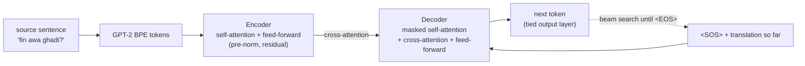

<div align="center">
  
  <h1>BIALinguaNet: Transformer-Based Language Translation Architecture</h1>
  <p>A custom implementation of a language translation model using Transformer architecture, enhanced with some fancy modifications. 😁</p>

  <p>
    <a href="https://colab.research.google.com/github/benisalla/BIA-Bilingual-Net/blob/main/notebooks/train_colab_kaggle.ipynb"></a>
    
    
    
    
  </p>
</div>

**Type a sentence in Moroccan Darija, get it in English, and the other way around.**
BIALinguaNet is an encoder-decoder Transformer written from scratch in plain PyTorch
(attention, masks, beam search, label-smoothed loss, learning-rate schedule), trained on
Darija ⇄ English sentence pairs and served in a Streamlit app.

---

## Table of Contents
- [About The Project](#about-the-project)
- [Features](#features)
- [How It Works](#how-it-works)
- [Project Structure](#project-structure)
- [Getting Started](#getting-started)
- [Data](#data)
- [Training](#training)
- [Fine-Tuning](#fine-tuning)
- [Training on Kaggle / Colab (notebook)](#training-on-kaggle--colab-notebook)
- [Tests and Sanity Checks](#tests-and-sanity-checks)
- [Translation Examples](#translation-examples)
- [Changelog: Fixes and Improvements](#changelog-fixes-and-improvements)
- [License](#license)
- [About Me](#about-me)
- [Connect with Me](#connect-with-me)

---

## About The Project

<div align="center">
  <h3>Watch the Demo Video</h3>
  <a href="https://youtu.be/tUHztFYTZ2U" target="_blank">
    
  </a>
  <p><em>Click the image above to watch the video on YouTube.</em></p>
</div>

BIALinguaNet uses powerful Transformer architectures to provide a reliable language translation system. Designed with simplicity and effectiveness in mind, this project makes it easier to develop neural networks for natural language processing, suitable for both academic research and practical use.

The model is versatile, allowing adjustments to meet various language and translation needs. By changing the transformer's input settings and the formats of the data being translated, users can customize the system to fit their specific requirements.

---

## Features

- **Bilingual Translation**: Supports translation between English and Darija, allowing users to switch seamlessly between the two languages.
- **Adjustable Model Settings**: Users can fine-tune the translation output by adjusting parameters such as temperature, top-k sampling, top-p sampling, beam size, and length normalization coefficient.
- **Real-time Translation**: Provides immediate translation results with an interactive interface that displays both the input and output texts.
- **Multiple Hypotheses Display**: Shows alternative translation hypotheses with associated confidence scores, giving users a range of translation options.
- **User-Friendly Interface**: The app features a visually appealing and intuitive design, making it easy for users to interact with the translation tool.
- **Customizable Translation Settings**: Allows users to control the translation process in detail, tailoring the output to their specific needs.
- **Train Anywhere**: one command on your machine, or a self-contained notebook on a free Kaggle / Colab GPU.
- **Tested**: 43 unit tests, including the standard neural-network sanity checks, and a one-command overfitting check on real data.

---

## How It Works



| Part | Choice |
|---|---|
| Tokenizer | GPT-2 BPE + `<PAD>`, `<SOS>`, `<EOS>` (50,260 tokens), **shared by both languages** |
| Embeddings | learned token + learned position embeddings (max 128 tokens); the encoder embedding, decoder embedding and output layer are **one tied matrix** |
| Blocks | pre-norm residual multi-head attention (`ResMHAtten`) and feed-forward (`ResFFNet`) |
| Default size | `n_emb=64`, 16 heads of size 4, 1 encoder + 1 decoder block, FFN ×3, dropout 0.2 → **3.4M parameters** |
| Loss | cross-entropy with label smoothing 0.1 (`LSRCrossEntropy`), averaged over real (non-padding) tokens |
| Optimizer | Adam (β = 0.9, 0.98, ε = 1e-9), weight decay 1e-4, gradient clipping 1.0 |
| Learning rate | warmup over 8,000 steps then 1/√step decay (the "Noam" schedule of *Attention Is All You Need*, ×2) |
| Batches | sentences grouped by length, ~1,000 target tokens per batch, 25 batches accumulated per optimizer step (~25k tokens) |
| Decoding | beam search with length normalisation, optional top-k / top-p filtering and temperature |

Every hyper-parameter lives in [`translation_engine/core/config.py`](translation_engine/core/config.py).

---

## Project Structure
```
BIA-Bilingual-Net
│
├── translation_engine
│   ├── app                    # Streamlit application
│   │   ├── style/style.css    # visual appearance of the app
│   │   ├── HTMLS.py           # HTML snippets (loading spinner)
│   │   ├── main.py            # the app: streamlit run translation_engine/app/main.py
│   │   └── utils.py           # loads the tokenizer and both checkpoints
│   │
│   ├── core
│   │   └── config.py          # all hyper-parameters (Config)
│   │
│   ├── data
│   │   ├── dataloader.py      # tokenizer + token-budget batching (DataLoader)
│   │   └── prepare_data.py    # downloads the Darija-English corpus, writes train/val/test json
│   │
│   ├── model
│   │   ├── BIALinguaNet.py    # encoder-decoder + beam-search translate()
│   │   ├── Encoder.py         # encoder stack
│   │   ├── Decoder.py         # decoder stack
│   │   ├── ResMHAtten.py      # residual multi-head (self / cross) attention
│   │   ├── ResFFNet.py        # residual feed-forward block
│   │   ├── LSRCrossEntropy.py # label-smoothing cross-entropy
│   │   └── utils.py           # lr schedule, checkpoints, train / validation loops (fit)
│   │
│   ├── src
│   │   ├── checkpoints        # dr_en_chpts.pth.tar, en_dr_chpts.pth.tar (not in git)
│   │   ├── dataset            # train / val / test json (not in git, see "Data")
│   │   └── img                # app background images
│   │
│   ├── train.py               # training script
│   └── finetune.py            # fine-tuning script
│
├── notebooks
│   ├── train_colab_kaggle.ipynb   # self-contained training notebook (Kaggle / Colab)
│   └── build_notebook.py          # regenerates the notebook from the package code
├── tests                      # unit tests and neural-network sanity checks (pytest)
├── pyproject.toml / poetry.lock
└── README.md
```

---

## Getting Started

Follow these simple steps to get a local copy up and running.

### Installation

1. Clone the repository
   ```sh
   git clone https://github.com/benisalla/BIA-Bilingual-Net.git
   cd BIA-Bilingual-Net
   ```
2. Install dependencies using Poetry (Python ≥ 3.11)
   ```sh
   poetry install
   ```
3. Activate the Poetry shell to set up your virtual environment
   ```sh
   poetry shell
   ```

All commands below are run **from the repository root**.

### Running the Application

The app loads two checkpoints, one per direction:

```
translation_engine/src/checkpoints/en_dr_chpts.pth.tar   # English -> Darija
translation_engine/src/checkpoints/dr_en_chpts.pth.tar   # Darija -> English
```

Train them (below, or with the notebook) or copy your own there, then:

```sh
poetry run streamlit run translation_engine/app/main.py
```

If a checkpoint is missing, the app says which file it expects instead of crashing.

---

## Data

```sh
poetry run python -m translation_engine.data.prepare_data
```

This downloads the [DODa](https://github.com/darija-open-dataset/dataset) sentence pairs
(Darija in Latin script, as packaged in
[atlasia/darija_english](https://huggingface.co/datasets/atlasia/darija_english)), removes
empty rows and duplicates (**44,631 pairs**), shuffles them with a fixed seed and writes:

| File | Pairs |
|---|---|
| `translation_engine/src/dataset/train.json` | 41,955 |
| `translation_engine/src/dataset/val.json` | 1,338 |
| `translation_engine/src/dataset/test.json` | 1,338 |
| `tiny_{train,val,test}.json` | 256 each, for quick checks |

Any other corpus works: a json list of `{"dr": "...", "en": "..."}` objects.

---

## Training

```sh
poetry run python -m translation_engine.train                      # Darija -> English
poetry run python -m translation_engine.train --direction en-dr    # English -> Darija
```

- The best model (lowest validation loss) is saved to `translation_engine/src/checkpoints/<src>_<tgt>_chpts.pth.tar`, the file the app loads, with a loss plot next to it.
- If that checkpoint already exists, training **resumes** from it (`--no-resume` to start over).
- Useful flags: `--n-steps`, `--epochs`, `--toks-in-batch`, `--batches-per-step`, `--warmup-steps`, `--data-dir`, `--checkpoint`. See `--help`.

### Sanity check first: overfit a small chunk of data

Before a long run, check that the model can **memorise** a few real pairs (no dropout, no label
smoothing, the validation set *is* those pairs):

```sh
poetry run python -m translation_engine.train --overfit 32
```

On 32 DODa pairs (laptop CPU, ~5 minutes) the loss goes from **11.03** (≈ ln 50,260 = 10.83, i.e. a
uniform guess) down to **0.033**, and the saved model translates **31 of the 32** sentences back
word for word. If this fails, something is broken, and full training would be wasted time.

---

## Fine-Tuning

To fine-tune a pre-trained model on new (or the same) data with a 10× smaller learning rate:

```sh
poetry run python -m translation_engine.finetune --direction dr-en --data-dir path/to/new_data
```

It starts from `translation_engine/src/checkpoints/<src>_<tgt>_chpts.pth.tar` (or `--pretrained`),
continues the learning-rate schedule where training stopped, and saves to
`<src>_<tgt>_finetuned_chpts.pth.tar` (or `--output`), so the original model is never overwritten.

---

## Training on Kaggle / Colab (notebook)

[`notebooks/train_colab_kaggle.ipynb`](notebooks/train_colab_kaggle.ipynb) trains the model on a
free GPU. It is **self-contained**: it writes the exact `translation_engine` code, downloads the
data, and walks through:

1. data preview and sentence-length histogram,
2. **neural-network sanity checks** on a real batch (initial loss ≈ ln(vocab), every parameter
   gets a gradient, causal decoder, padding ignored),
3. **overfitting a small chunk** (the model must memorise 32 pairs exactly),
4. full training with a live loss plot, resume after a disconnect, and a time budget for the 12 h session limit,
5. translations of unseen test sentences, and a zip of the checkpoint to download.

Set `DIRECTION = "dr-en"` or `"en-dr"` and press **Run all**; `SMOKE_TEST = True` checks
the whole notebook in a few minutes. After changing the package, regenerate it with
`python notebooks/build_notebook.py`.

---

## Tests and Sanity Checks

```sh
poetry run pytest          # 43 tests, CPU only, ~1 minute
```

| File | What it checks |
|---|---|
| `tests/test_model.py` | output shape; **initial loss ≈ ln(vocab)**; **every parameter gets a gradient**; the decoder is **causal**; source and target **padding are ignored**; **samples in a batch don't interact**; dropout only in train mode; tied weights; checkpoints from GPU load on CPU; the model **overfits one batch** |
| `tests/test_loss_and_decoding.py` | the label-smoothing loss equals PyTorch's `cross_entropy(label_smoothing=…)` and ignores padding; top-k / top-p filtering; beam search **recovers memorised sentences**, never overflows `max_seq_len`, and ignores tokens removed by top-p |
| `tests/test_data_and_training.py` | every pair appears once per epoch with `<SOS>`/`<EOS>`; token budget; long / empty pairs dropped; config; lr schedule; **gradient accumulation = one big batch**; token-weighted validation; checkpoint round trip; `fit()` learns; `train.py --overfit` → resume → `finetune.py` → app model, end to end; the **Streamlit app** itself (missing model, then a real translation) |
| `tests/test_notebook.py` | the notebook embeds the current package code and is valid Python |

---

## Translation Examples

Below are demonstrations of translations performed by the BIALinguaNet model, showcasing its capabilities for both English to Darija (En to Dr) and Darija to English (Dr to En) translations.

#### Scripts Used for Generating Examples:

```python
def translate_all(sentences, model, tokenizer):

    translations = []
    for sentence in sentences:
        best_hypo, _ = model.translate(
            sx=sentence,
            tokenizer=tokenizer,
            temperature=1.0,
            beam_size=4,
            len_norm_coeff=0.6,
            top_k=50,
            top_p=0.95,
            is_ltr=False,
            max_beam_fork=128
        )
        translations.append((sentence, best_hypo))
    return translations

def display_translations(translated_pairs):
    HEADER = '\033[95m'
    OKBLUE = '\033[94m'
    OKGREEN = '\033[92m'
    ENDC = '\033[0m'
    BOLD = '\033[1m'

    print(HEADER + BOLD + "Translations" + ENDC)
    for darija, english in translated_pairs:
        print(f"{OKBLUE}Darija:{ENDC} {darija.ljust(30)} {OKGREEN}English:{ENDC} {english}")
```

Load a trained model and its tokenizer with:

```python
from translation_engine.app.utils import load_model, load_tokenizer

model = load_model("translation_engine/src/checkpoints/dr_en_chpts.pth.tar")
tokenizer = load_tokenizer()
display_translations(translate_all(["fin awa ghadi?", "Mashi mochkil"], model, tokenizer))
```

#### Decoding settings

| Setting | Meaning |
|---|---|
| `beam_size` | number of candidate translations kept at each step (1 = greedy) |
| `len_norm_coeff` | length normalisation; 0 favours short translations, higher values favour longer ones |
| `top_k` / `top_p` | each beam only extends its `top_k` most likely tokens / the smallest set covering `top_p` of the probability |
| `temperature` | 1.0 = the model's own probabilities; < 1 sharper, > 1 flatter |
| `max_beam_fork` | maximum number of generated tokens (also capped by the model's `max_seq_len`) |

#### Visual Examples:
The following images provide visual confirmations of the translations facilitated by BIALinguaNet:

**From Darija to English:**


**From English to Darija:**


---

## Changelog: Fixes and Improvements

A code review found these problems in the first version. All are fixed, with tests. **The model
architecture and parameter names are unchanged, so existing checkpoints load as before** (verified:
identical outputs).

| Problem | Effect | Fix |
|---|---|---|
| `optimizer.zero_grad()` was called before every batch while gradients were "accumulated" over 25 batches | each optimizer step only used the **last** of its 25 batches: 96% of the data never contributed to training | gradients are accumulated over all `batches_per_step` batches (scaled by 1/25), then clipped, then one step |
| Beam search stopped as soon as `beam_size` hypotheses had ended | short, unlikely sentences that ended early could beat the right, longer translation | stops only when no unfinished beam can still beat the best finished one |
| Beam search expanded tokens removed by top-k / top-p (score −∞) | the beam filled with random −∞ hypotheses, which could be returned as the translation | only finite candidates are expanded |
| Generating past `max_seq_len` (default `max_beam_fork=128`) or translating a long input | crash (position embedding out of range) | input truncated, generation capped at `max_seq_len` |
| Validation loader hard-coded to `dr → en` | `en → dr` models were validated in the wrong direction | validation uses the training direction |
| Resuming called `load_checkpoint(model=…, optimizer=…)` | `TypeError` as soon as a checkpoint existed | fixed call; resume continues from the saved epoch |
| `save_checkpoint(..., prefix=…)` in the last two epochs | `TypeError` at the end of training | fixed signature |
| Training saved to `src/`, the app and fine-tuning read `src/checkpoints/` | trained models were not found by the app | one path: `src/checkpoints/<src>_<tgt>_chpts.pth.tar` |
| Fine-tuning reset the learning rate to the full schedule after one step and overwrote the original checkpoint | the "10× smaller" fine-tuning rate was not applied | `lr_scale` applied at every step; output in a separate file |
| `temperature + 1.0` was used as the temperature | `temperature=1.0` actually meant 2.0 | standard temperature (1.0 = unchanged) |
| Attention masks built with the device given at construction, and self- vs cross-attention detected by comparing tensor values | crashes when a model moved device; a full tensor comparison per attention call | masks follow the input's device; explicit `is_self` flag |
| Label smoothing built a dense `[tokens × 50,260]` target matrix | slow and memory hungry | same loss computed in closed form (~1.8× faster per batch on CPU) |
| Batches with a sentence longer than `toks_in_batch` | `range()` step of 0 → crash | at least one sentence per batch; too-long pairs filtered |
| `plt.show()` in the training loop | blocked training in a terminal | plot saved to a png (still live in notebooks) |
| App: model output inserted as raw HTML, forced right-to-left, unused `regex` import, paths relative to the working directory | broken display for English / special characters; crash if launched from another folder | escaped, `dir="auto"`, paths relative to the package |

Also new: data preparation script, `--overfit` sanity check, CLI flags, the Kaggle / Colab notebook and the test suite.

---

## License

This project is made available under **fair use guidelines**. While there is no formal license associated with the repository, users are encouraged to credit the source if they utilize or adapt the code in their work. This approach promotes ethical practices and contributions to the open-source community. For citation purposes, please use the following:

```bibtex
@misc{bialinguanet_2024,
  title={BIALinguaNet: Transformer-based Language Translation Architecture},
  author={Ben Alla Ismail},
  year={2024},
  url={https://github.com/benisalla/BIA-Bilingual-Net}
}
```

---

## About Me

🎓 **Ismail Ben Alla** - AI, NLP, and Computer Vision Junior Engineer Graduated From **École nationale des sciences appliquées de Fès** and currently a student at **École Centrale de Lyon**

Deeply passionate about artificial intelligence (AI), Computer vision and natural language processing (NLP). My academic and professional journey showcases a dedicated commitment to exploring AI’s potential to bridge language barriers and connect cultures. I love building things from scratch and i am particularly enthusiastic about training neural networks and watch them learning and fix their issues.

In my pursuit of knowledge, I am driven to advance AI, deep learning, and machine learning technologies, constantly seeking innovative solutions that push the boundaries of what's possible in the tech world.

---

### Connect with Me

<div align="center">
  <a href="https://twitter.com/ismail_ben_alla" target="_blank">
    
  </a>

  <a href="https://linkedin.com/in/ismail-ben-alla-7144b5221/" target="_blank">
    
  </a>

  <a href="https://instagram.com/ismail_ben_alla" target="_blank">
    
  </a>
</div>

---

<div align="center">
  <h4>🌐📚🔁 Dive into the world of language with BIA LinguaNet—experience seamless Moroccan Darija to English translations and vice versa! 🌐📚🔁</h4>
  
</div>
